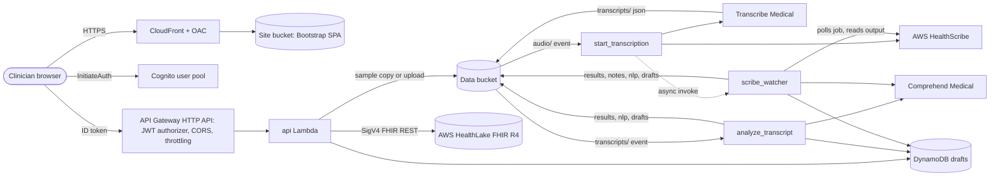
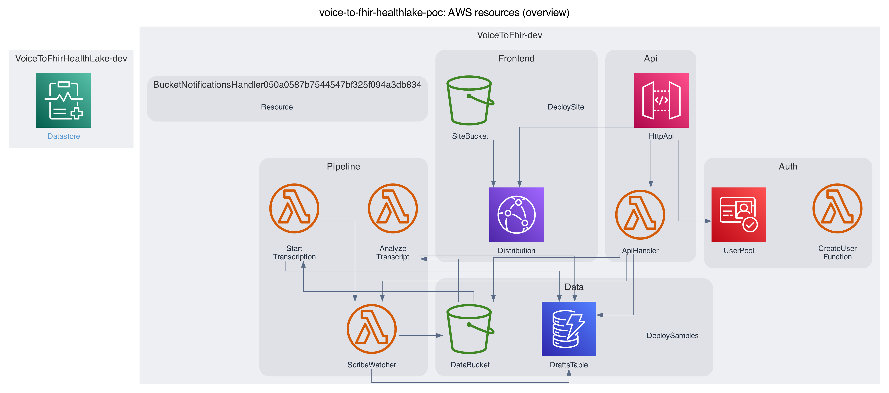
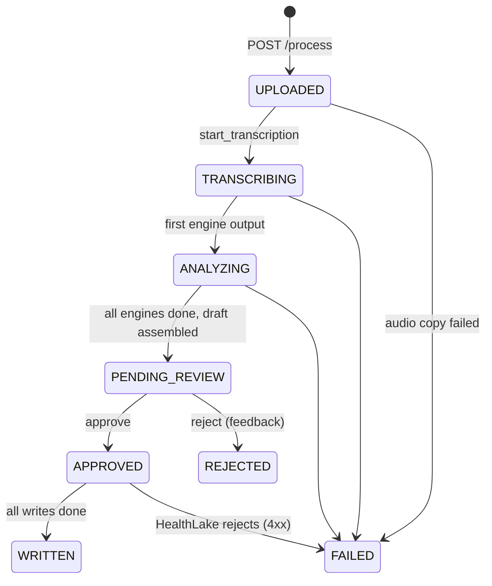

# voice-to-fhir-healthlake-poc

Speech → structured FHIR → clinician-approved write to AWS HealthLake, built on S3 events and serverless AWS
services. A Python CDK proof of concept: a clinician picks a synthetic patient and a consultation recording,
the recording is transcribed and analysed (**Amazon Transcribe Medical** and/or **AWS HealthScribe**, plus
**Amazon Comprehend Medical**), draft FHIR R4 resources are reviewed in a Bootstrap web UI, and only what the
clinician approves is written to **AWS HealthLake**.

> **Disclaimer.** Independent project, not affiliated with or endorsed by AWS. **Synthetic data only.** Never
> use real patient data or recordings. Output is AI-generated and for clinician review. Not medical advice,
> not a medical device, not production software.

**Contents:** [What it does](#what-it-does) · [Architecture](#architecture) · [Prerequisites](#prerequisites) ·
[Deploy](#deploy) · [Sample data](#sample-data) · [5-minute demo](#5-minute-demo-script) · [Cost](#cost) ·
[Cleanup](#cleanup) · [Known limitations](#known-limitations) · [Repository layout](#repository-layout) ·
[Testing](#testing) · More detail: [docs/architecture.md](docs/architecture.md), [docs/testing.md](docs/testing.md)

## What it does

- **Sign in** as the demo clinician (Cognito, no hosted UI).
- **Patients**: an EHR-style chart per synthetic patient, read live from HealthLake: problem list, medications,
  latest vitals and labs, encounters, clinical notes. **View FHIR record in HealthLake** shows the exact signed
  request and HealthLake's raw response, as proof of what is stored.
- **Start a consultation** from a bundled sample (or an uploaded *synthetic* recording up to 4 MB: see
  [Uploading your own recording](#uploading-your-own-recording)). Choose the
  AI engine: Transcribe Medical, AWS HealthScribe, or **both side by side**. Choose a HealthScribe note
  template and optional patient pronouns.
- **Pipeline** (S3 events + Lambda): transcription → Comprehend Medical (entities, ICD-10-CM, RxNorm) → draft
  FHIR (DocumentReference, Condition, MedicationStatement, and with HealthScribe a clinical-note
  DocumentReference).
- **Review**: audio player, transcript with speaker roles (and HealthScribe sections), NLP entities, proposed
  FHIR resources (flagged items unticked; negated and family-history items excluded with the reason), the
  HealthScribe clinical note with **evidence links**, and an engine comparison. Edit or add resources, set the
  consultation date and time, then **approve** (optional feedback) or **reject** (feedback required).
- **Approve** writes only the ticked resources, plus an Encounter and Provenance (AI pipeline as author, the
  clinician as verifier), to HealthLake. It is idempotent and resumable.
- **Drafts** page, per-draft URLs, and editing an encounter's date and time after writing (new version +
  Provenance).
- **Times** are shown and entered in IST (UTC+05:30), whatever the browser's time zone; the API, DynamoDB and
  HealthLake store UTC. The signed-in clinician is shown by name (Cognito `name`, default **John Smith**).
- **Web UI:** plain HTML, ES modules and vendored Bootstrap: navy header, card layout, review action bar that
  stays in view, inline SVG icons and an SVG favicon. No build step, web fonts or external calls.

## Architecture

One CDK app, one main stack (`VoiceToFhir-<env>`), plus an optional HealthLake stack. No Docker, and the
Lambdas use only the Python 3.12 standard library + boto3.



**Generated resource diagram.** [CDK Graph](https://github.com/aws/aws-pdk) draws this from the CDK app itself,
so it always matches what `cdk deploy` creates. The overview shows the main components and their references
(IAM, log groups, CloudFront plumbing and CDK helper resources are hidden). Runtime service calls (Transcribe
Medical, HealthScribe, Comprehend Medical, the HealthLake FHIR API) are not CloudFormation resources, so they
appear only in the flow diagram above. The datastore in its own stack therefore looks unconnected, although
the API Lambda reads and writes it.



Full-resolution SVG: [docs/images/architecture.svg](docs/images/architecture.svg). Detailed version with every
resource (IAM, log groups, API routes, Lambda permissions): [docs/images/architecture-detailed.svg](docs/images/architecture-detailed.svg).

**Slide-ready diagram** (16:9, hand-drawn, numbered flow):
[docs/images/architecture-presentation.svg](docs/images/architecture-presentation.svg), plus a 3840×2160 PNG
[docs/images/architecture-presentation.png](docs/images/architecture-presentation.png).
To regenerate after changing the infrastructure (no AWS calls):

```bash
python3 -m venv .venv-diagram && source .venv-diagram/bin/activate
pip install -r requirements-diagram.txt
python scripts/generate_architecture_diagram.py      # writes docs/images/architecture.{svg,png}, architecture-detailed.svg
```

CDK Graph is part of AWS PDK, which AWS **no longer supports** (it recommends the Nx Plugin for AWS). It is
used here only as a documentation tool, in its own virtualenv. The deployed app does not depend on it.
`aws-pdk==0.26.15` works with the pinned `aws-cdk-lib` 2.278.0.

Draft lifecycle (DynamoDB `status`):



Details (S3 layout, engines, API routes, FHIR mapping rules, approve semantics, security):
[docs/architecture.md](docs/architecture.md).

## Prerequisites

- Python 3.12, Node.js (for the CDK CLI), AWS CDK CLI v2, AWS CLI v2. No Docker.
- An AWS sandbox account and profile (examples use `personal_sandbox_cdk`). Use **us-east-1**: AWS
  HealthScribe is only available there, and HealthLake, Transcribe Medical and Comprehend Medical are too.
- Bootstrapped CDK environment (`cdk bootstrap`).

## Deploy

```bash
python3 -m venv .venv && source .venv/bin/activate
pip install -r requirements-dev.txt
export AWS_PROFILE=personal_sandbox_cdk

pytest -q                                                    # local tests, no AWS calls
python scripts/generate_sample_audio.py --profile $AWS_PROFILE                     # sample audio (Polly)
python scripts/generate_sample_audio.py --profile $AWS_PROFILE --only consult-01 --stereo  # + stereo sample
cdk bootstrap                                                # once per account/region
cdk synth

# Default path: reuse an existing HealthLake datastore.
cdk deploy VoiceToFhir-dev \
  -c existingHealthLakeDatastoreId=<datastore-id> \
  --parameters DemoUserPassword='<Synthetic-Demo-Pass1>' \
  -c demoUserEmail=clinician.demo@example.com
```

No datastore yet? Create one first (billed per hour while it exists), load the sample patients, then deploy the
app as above with its id:

```bash
cdk deploy VoiceToFhirHealthLake-dev            # prints DatastoreId (took about 3 minutes in testing)
python scripts/load_sample_healthlake_data.py --datastore-id <DatastoreId> --profile $AWS_PROFILE
```

- **Password:** `--parameters DemoUserPassword=…` keeps it out of the template. The policy requires 8+
  characters with upper case, lower case and a digit. `-c demoUserPassword=…` also works, but the value is
  stored as the parameter default in the template, and synth warns. Later deploys reuse the previous value.
- **Context keys** (`-c key=value`, defaults in `cdk.json`): `environment` (`dev`), `region` (`us-east-1`),
  `demoUserEmail`, `demoUserName` (`John Smith`: the demo user's Cognito `name`, shown in the header and as the
  Provenance verifier), `demoUserPassword`, `existingHealthLakeDatastoreId`.
- **Outputs:** `SiteUrl`, `ApiUrl`, `UserPoolId`, `UserPoolClientId`, `DataBucketName`, `DraftsTableName`,
  `HealthLakeDatastoreId`.
- Without `existingHealthLakeDatastoreId`, the app stack imports the id from `VoiceToFhirHealthLake-<env>`.

## Sample data

All people, conversations and values are synthetic.

**Patients:** `scripts/load_sample_healthlake_data.py` loads 3 patients (adapted from the reference repo, same ids)
with conditions, observations, encounters and medication requests. Ids are deterministic and written with PUT,
so re-runs update in place, and it refuses to run if the datastore already holds other records for these
patients (`--force` to override, `--dry-run` to preview).

**Consultations:** `scripts/generate_sample_audio.py` uses Amazon Polly (two voices, 16 kHz PCM wrapped as WAV, no
ffmpeg). The WAVs are gitignored and published to `s3://<DataBucketName>/samples/` on deploy.

| Sample | Patient (id prefix) | Covers |
|---|---|---|
| `consult-01-knee-pain-blood-pressure.wav` | Elena Rodriguez (`0725e407`) | negated symptoms, family history, uncontrolled hypertension, new medication |
| `consult-01-knee-pain-blood-pressure-stereo.wav` | Elena Rodriguez | the same consult in stereo (clinician left, patient right) for channel identification |
| `consult-02-gout-follow-up.wav` | Márcia Oliveria (`69834515`) | medication change (stop/start), "could be" anemia |
| `consult-03-cough.wav` | Diego Ramirez (`46383dd7`) | family history, "could be" bronchitis, stopped medication |

The scripts are in `scripts/consult_scripts.py`. Reading one aloud makes a good synthetic recording to upload.

### Uploading your own recording

Uploads go through the API (API Gateway → Lambda, base64-encoded), so a file must be **4 MB or smaller**,
recorded at **16 kHz or higher**, as WAV, MP3, FLAC or M4A. Only upload synthetic recordings (for example a
script read aloud), and tick the confirmation box.

Uncompressed WAV fills 4 MB fast (48 kHz, 24-bit stereo is about 17 MB per minute). Compressed 16 kHz mono
fits far more: AAC at 32 kbps is about 0.24 MB per minute, so roughly 16 minutes fits under 4 MB. With the
macOS built-in `afconvert` (no install), convert in two steps, because `afconvert` will not downmix stereo
while encoding AAC:

```bash
afinfo recording.wav | grep -E "Data format|duration"                        # what you have
afconvert -f WAVE -d LEI16@16000 -c 1 --mix recording.wav /tmp/mono16k.wav    # 1. 16 kHz mono PCM
afconvert -f m4af -d aac -b 32000 /tmp/mono16k.wav recording.m4a              # 2. AAC, 32 kbps
rm /tmp/mono16k.wav
```

Example: a 4 min 20 s, 75 MB WAV (48 kHz, 24-bit stereo) became a 1.0 MB M4A. With ffmpeg instead:
`ffmpeg -i recording.wav -ac 1 -ar 16000 -b:a 32k recording.m4a`.

Keep both channels (`-c 2`, and skip `--mix`) only if the recording is split clinician-left / patient-right,
which lets the app take speaker roles from the channels. That doubles the size. Longer recordings need splitting,
or a direct-to-S3 upload, which is not built (see [Known limitations](#known-limitations)).

## 5-minute demo script

Before the audience arrives: sign in once, and process one consult with **Both** engines so a finished draft
is ready on **Drafts** in case the network is slow. HealthScribe takes about 1–2 minutes per one-minute
recording.

| Time | Do | Say |
|---|---|---|
| 0:00 | Open `SiteUrl`, sign in | Synthetic data only; Cognito sign-in straight from the browser |
| 0:30 | **Patients** → Elena Rodriguez | An EHR-style chart read live from AWS HealthLake |
| 1:00 | **View FHIR record in HealthLake** → Condition | The exact signed request, HTTP 200, HealthLake's request id, raw FHIR |
| 1:30 | Start a consultation: `consult-01…`, engine **Both**, template History and physical → Process | S3 event starts Transcribe Medical and HealthScribe in parallel; the status shows each engine |
| 2:00 | While it runs (or open the prepared draft): **Drafts** → Review | One draft per encounter, with its own URL |
| 2:15 | Review: play audio; **Transcript** | Speaker roles from HealthScribe, plus a section per turn |
| 2:45 | **NLP entities** → **FHIR resources** | Comprehend Medical codes; negated fever and the father's heart attack excluded; low-confidence items flagged and unticked |
| 3:15 | **Clinical note** → click a sentence | HealthScribe's note; evidence links show exactly what was said |
| 3:45 | **Compare engines** | Same recording, two engines: roles, findings, transcripts |
| 4:00 | **Edit** the flagged hypertension → Confirmed; tick the note; set **Consultation date and time**; **Approve** with a comment | Nothing reaches HealthLake before this click; Provenance names the AI pipeline and the clinician |
| 4:30 | **Done** → **Patients** → Elena | New problem and note badged "AI-assisted"; **View FHIR record** shows them with `AIAST` |

## Cost

At demo scale the HealthLake datastore dominates. Prices change, so check the AWS pricing pages.

| Service | How it is billed | Notes |
|---|---|---|
| [AWS HealthLake](https://aws.amazon.com/healthlake/pricing/) | per datastore-hour (about $0.27/hour, about $6.50/day, at the time of writing) | Billed even when idle. Destroy it when not demoing |
| [Amazon Transcribe Medical](https://aws.amazon.com/transcribe/pricing/) | per audio minute | One job per consultation (Transcribe Medical or Both engines) |
| [AWS HealthScribe](https://aws.amazon.com/healthscribe/pricing/) | per audio minute | One job per consultation, plus one per "Generate with another template" |
| [Amazon Comprehend Medical](https://aws.amazon.com/comprehend/medical/pricing/) | per 100-character unit | 3 APIs per transcript; twice with Both engines |
| [Amazon Polly](https://aws.amazon.com/polly/pricing/) | per character | Only when generating the sample audio |
| Lambda, API Gateway, S3, DynamoDB (on-demand), CloudFront, Cognito (Lite) | per request / GB | Negligible for a demo |

## Cleanup

```bash
cdk destroy VoiceToFhir-dev -c existingHealthLakeDatastoreId=<datastore-id>   # app stack first
cdk destroy VoiceToFhirHealthLake-dev   # only if this project created the datastore: deletes it and all its data
```

- Buckets auto-empty and every resource uses `RemovalPolicy.DESTROY`, so nothing is left in S3, DynamoDB or
  CloudWatch Logs (1-week retention).
- If the app stack was deployed *without* `existingHealthLakeDatastoreId`, it imports the datastore id from the
  HealthLake stack. Destroy the app stack first.
- Transcribe Medical and HealthScribe job records stay in the account's job lists (not the output, which was in
  the deleted bucket). Delete them with `aws transcribe delete-medical-transcription-job` /
  `delete-medical-scribe-job` if you want a clean list.
- Run `load_sample_healthlake_data.py` again to restore the sample patients in a reused datastore. Approved demo
  resources are not removed by it.

## Known limitations

- **Demo scope:** synthetic data, one demo clinician, no token refresh (1-hour session), drafts list not
  filtered by user, last save wins on concurrent edits.
- **Speaker roles (Transcribe Medical path):** the first speaker is assumed to be the clinician. Stereo uses the
  channel convention (left = clinician). HealthScribe assigns roles itself.
- **NLP:** Comprehend Medical has no "stopped" or "dose changed" trait (fix it with **Edit** → status). The
  confidence rules are heuristics: entity score < 0.80, or code score < 0.30, is flagged.
- **HealthScribe:** generative output can be wrong (the note is flagged and unticked by default); us-east-1
  only; no medical codes (Comprehend Medical adds them); the watcher waits up to about 12 minutes per job.
- **Approve:** per-resource writes, not one transaction. A retry resumes safely, but a Lambda crash between a
  write and storing its id could write that one resource twice.
- **HealthLake:** `Patient/$everything` is not supported by the datastore, so the chart uses one search per
  resource type (up to 100 per type, 20 patients).
- **Upload:** 4 MB maximum (it goes through the API, not directly to S3; compress first, see
  [Uploading your own recording](#uploading-your-own-recording)). MP3/M4A/FLAC sample rate is not checked before
  upload. Lifting the limit needs presigned direct-to-S3 uploads (bucket CORS, CSP and an audio check moved
  into `start_transcription`).
- **CSP:** allows `https://*.execute-api.<region>.amazonaws.com` rather than the exact API URL, to avoid a
  CloudFormation cycle (see [docs/architecture.md](docs/architecture.md#design-decisions)).
- **Provenance:** one record covers all AI-derived resources of a draft; agents are identified by display
  name/identifier, not by linked Device or Practitioner resources. The confidence extension uses an
  `example.org` URL.
- **Frontend size:** about 1,190 lines of JS in 8 modules, beyond the original ~600-line target, after the
  features added since M4.

## Repository layout

| Path | What |
|---|---|
| `app.py`, `cdk.json`, `voice_to_fhir/build.py`, `voice_to_fhir/config.py` | CDK app (`build_app` defines the stacks, shared with the diagram script) and context settings |
| `voice_to_fhir/app_stack.py` | the main stack, built from constructs in `voice_to_fhir/components/` |
| `voice_to_fhir/components/` | `auth.py` (Cognito), `data.py` (buckets, table, samples), `pipeline.py` (pipeline Lambdas, HealthScribe role, S3 notifications), `api.py` (HTTP API), `frontend.py` (CloudFront, CSP, site deployment) |
| `voice_to_fhir/healthlake_stack.py` | optional HealthLake datastore stack |
| `lambdas/` | one code asset: `start_transcription.py`, `analyze_transcript.py`, `scribe_watcher.py`, `api.py` |
| `lambdas/shared/` | parsing, NLP chunking, FHIR mapping and validation, HealthScribe, engine assembly, approve, edits, encounters, chart, HealthLake client, drafts table |
| `frontend/` | `index.html`, `css/custom.css`, `js/` (`auth`, `api`, `views`, `chart`, `edit`, `record`, `scribe`, `main`), `favicon.svg` (+ `favicon-32.png`, `apple-touch-icon.png`), vendored Bootstrap |
| `scripts/` | sample patients loader, consult scripts, Polly audio generator, `run_sample.py`, `api_smoke.py`, `generate_architecture_diagram.py` (CDK Graph) |
| `tests/` | `unit/` (Lambdas, moto + fakes), `cdk/` (assertions), `ui/mock_api.py` (local mock for UI checks) |
| `docs/` | `architecture.md`, `testing.md`, `images/` (generated CDK Graph diagrams) |
| `requirements*.txt` | pinned app, dev, and optional diagram (`aws-pdk`) dependencies |

## Testing

`pytest -q` runs the unit and CDK assertion tests (no AWS calls). `python tests/ui/mock_api.py` serves the real UI
against a local mock. Scripts, the smoke checklist and how the UI was checked: [docs/testing.md](docs/testing.md).

## Third-party: Bootstrap

- Version **5.3.9**, vendored in `frontend/vendor/bootstrap-5.3.9/` (`bootstrap.min.css`,
  `bootstrap.bundle.min.js`, `LICENSE`). Licence: **MIT** (© The Bootstrap Authors).
- Source: npm `bootstrap@5.3.9`, tarball integrity
  `sha512-20cU0rcfw8WdxtVbmfU+xT2EjvVTw9Ror/h1Qvd7DXCujRg8OO9mdBCsmTHdJFf3BuadmBNJtgIuUXsBqSkk/w==`.
- SHA-256: `bootstrap.min.css` `9caac977a0af0c2229abd397eee3345899c4020da2a1a0b711c1cc543fe3719d`,
  `bootstrap.bundle.min.js` `4ad2ad30a7df1fa0a615c4cfeb1aeffbe92019a8dff0262c99464acbd56dca5c`.
- Vendored rather than loaded from a CDN, so the demo makes no external calls and the CSP stays `script-src 'self'`.

## Disclaimer

This is an independent proof of concept, not affiliated with, endorsed by, or supported by Amazon Web Services.
It processes **synthetic data only**: the patients, conversations and recordings are invented. Do not upload or
load real patient information. Transcripts, entities, codes and clinical notes are AI-generated and may be
wrong. Every item must be reviewed by a qualified clinician, and nothing here is medical advice or a medical
device. AWS states that Transcribe Medical, Comprehend Medical and HealthScribe output should only be used in
patient care after review for accuracy and sound medical judgment by trained professionals. Not production
software: no SLA, no hardening beyond the security baseline described in
[docs/architecture.md](docs/architecture.md#security-and-privacy).
